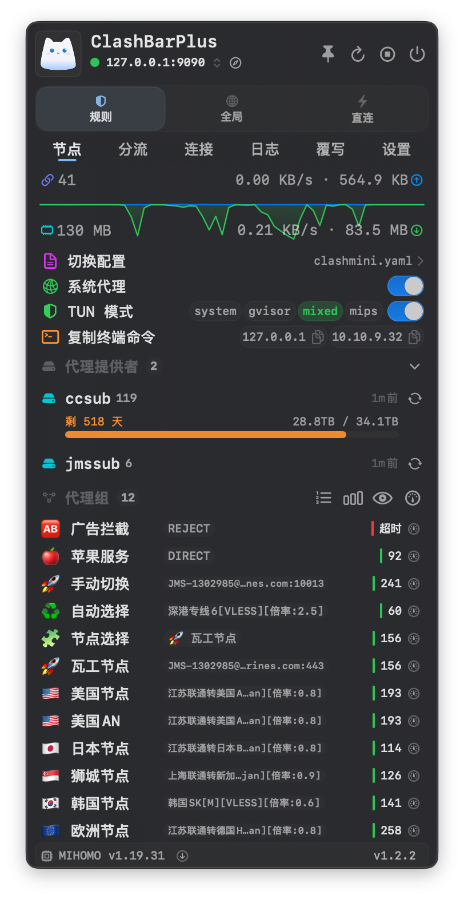
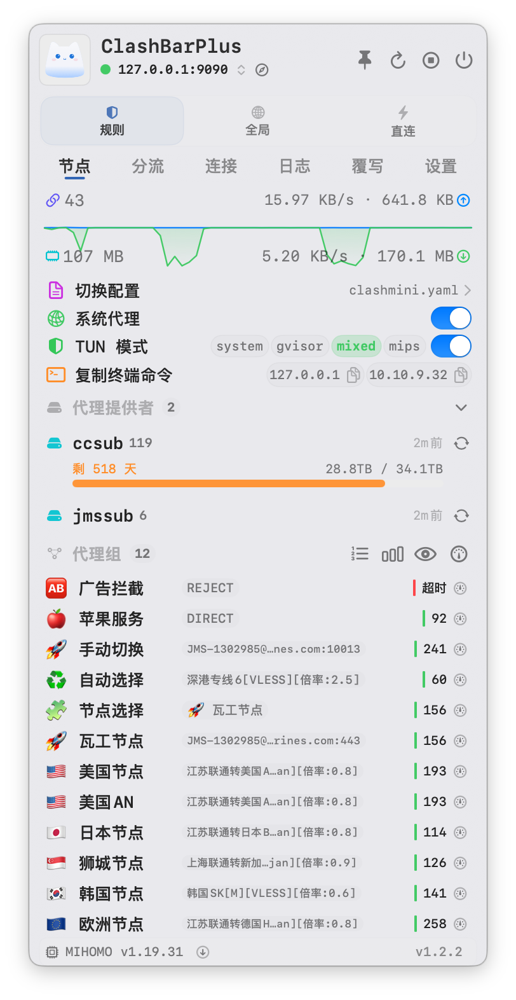

<div align="center">


# ClashBarX

原生 macOS 菜单栏代理客户端，基于 `SwiftUI + AppKit`，由 `mihomo` 驱动。
轻量、稳定，在菜单栏完成配置、节点、规则、连接与系统代理管理。 ✨

> **本仓库是 [Sitoi/ClashBar](https://github.com/Sitoi/ClashBar) 的整合发行版（ClashBarX）。**  
> 在上游基础上整合了 [mh567](https://github.com/mh567/ClashBar)、[kingcanfish](https://github.com/kingcanfish/ClashBar)、[Gongsc](https://github.com/Gongsc/ClashBar)、[flowke](https://github.com/flowke/ClashBar) 四个社区 fork 的优秀变更。  
> 安装包、应用内更新、版本号与文档都以本仓库为准，与上游的 `0.3.x` 版本和 Homebrew tap 相互独立。

<p>
  
  
  
  
  
  <a href="https://github.com/believems/ClashBarX/releases" target="_blank" rel="noopener noreferrer">
    
  </a>
  <a href="https://github.com/believems/ClashBarX/stargazers" target="_blank" rel="noopener noreferrer">
    
  </a>
  <a href="https://github.com/believems/ClashBarX/issues" target="_blank" rel="noopener noreferrer">
    
  </a>
  <a href="https://github.com/believems/ClashBarX/pulls" target="_blank" rel="noopener noreferrer">
    
  </a>
  <a href="https://github.com/believems/ClashBarX/network/members" target="_blank" rel="noopener noreferrer">
    
  </a>
  <a href="https://github.com/believems/ClashBarX/releases" target="_blank" rel="noopener noreferrer">
    
  </a>
  <a href="https://github.com/believems/ClashBarX/commits" target="_blank" rel="noopener noreferrer">
    
  </a>
  <a href="https://github.com/believems/ClashBarX/commits" target="_blank" rel="noopener noreferrer">
    
  </a>
  <a href="https://github.com/believems/ClashBarX/blob/main/LICENSE" target="_blank" rel="noopener noreferrer">
    
  </a>
</p>

<p>
  📦 <a href="https://github.com/believems/ClashBarX/releases"><strong>Releases</strong></a>
  ·
  🧾 <a href="./CHANGELOG.md"><strong>更新日志</strong></a>
  ·
  🛠 <a href="./docs/MAINTENANCE.md"><strong>维护说明</strong></a>
</p>

</div>

<p>
  
  
</p>

## 🔀 与上游的关系

ClashBarX 是 [Sitoi/ClashBar](https://github.com/Sitoi/ClashBar) 的整合发行版，基于上游 main 分支（v0.3.8 之后），整合四个社区 fork 的精选变更，并会持续同步上游更新。

|                | ClashBarX                                        | 上游 ClashBar                    |
| -------------- | ------------------------------------------------ | -------------------------------- |
| 版本号         | 自 `v1.0.0` 起独立编号，不跟随上游               | `v0.3.x`                         |
| 安装方式       | 仅 Releases 下载 DMG                             | Homebrew Cask / DMG              |
| Bundle ID      | `com.clashbar`（与上游一致）                     | `com.clashbar`                   |
| 数据目录       | `~/.config/clashbar`（首次运行自动从旧目录迁移）| `~/Library/Application Support/clashbar` |

> [!IMPORTANT]
> ClashBarX 保留了上游的 Bundle ID 与特权助手标签，且首启会自动把旧数据目录迁移到
> `~/.config/clashbar`。这意味着**覆盖安装即原地升级**——既有配置、订阅、设置以及
> 「登录项」里的助手授权全部保留，无需重新配置。代价是它与原版 ClashBar **不能并存**，
> 请先卸载原版再安装。

与上游及各 fork 的差异记录在 [CHANGELOG.md](./CHANGELOG.md)；v0.3.6 及更早的历史见[上游更新日志](https://github.com/Sitoi/ClashBar/blob/main/CHANGELOG.md)。

## ✨ 特点

- 🪶 **轻量**：去掉 Core 约 3 MB 内
- 🧭 **菜单栏优先**：配置导入/更新、节点切换、延迟测试、规则与连接排障
- 🔐 **系统集成**：系统代理、TUN、开机启动
- 📊 **可观测**：实时流量、连接、内存、日志过滤
- 🌍 **中英双语**：简体中文 / English

### 🔀 与上游的关系

本仓库是上游的 fork，使用独立的 `v1.x` 版本序列，安装包与应用内更新都来自本仓库 Releases；`brew install --cask clashbar` 安装的是上游版本。分支模型与发版流程见 [docs/MAINTENANCE.md](./docs/MAINTENANCE.md)。

### 📏 体积对比（macOS Finder 显示值，仅供参考）

| 客户端                     |     体积 |
| -------------------------- | -------: |
| ClashBarX.app (No Core) |     3 MB |
| ClashMac.app               |  75.2 MB |
| Clash Verge.app            | 128.4 MB |
| Clash Party.app            | 496.7 MB |

## 📦 安装

**要求：** macOS 13+ 🍎

1. 打开 [ClashBarX Releases](https://github.com/believems/ClashBarX/releases)，下载最新的 `.dmg`。
2. 把 `ClashBar.app` 拖入 `/Applications`。
3. 首次打开若被系统拦截，到「系统设置 → 隐私与安全性」中放行。

发布策略：**只提供 GitHub Releases 下载，不发布 Homebrew Cask；安装包不内置 mihomo 内核（体积更小、内核由用户自备并自行升级），同时提供 Apple Silicon 与 Intel 双架构**。每个版本提供 2 个产物：

| 文件名                              | 适用                     |
| ----------------------------------- | ------------------------ |
| `ClashBarX-<版本>-apple-silicon.dmg` | Apple Silicon，自备内核 |
| `ClashBarX-<版本>-intel.dmg`         | Intel，自备内核          |

> [!TIP]
> 自备内核：在「设置 → 核心」中选择本机已安装的 mihomo，
> 或从 [mihomo Releases](https://github.com/MetaCubeX/mihomo/releases) 下载对应架构的内核后选择。

> [!NOTE]
> 本仓库的安装包使用 ad-hoc 签名，未做 Apple 公证。上游的 Homebrew tap
> （`brew install --cask clashbar`）安装的是上游版本，不会得到本仓库的构建，
> 应用内更新也不会跟踪到这里。若此前用 Homebrew 装过上游版本，请先
> `brew uninstall --cask clashbar` 再安装本版本，否则 Homebrew 升级会覆盖回上游。

卸载：删除 `/Applications/ClashBar.app`，并清理 `~/Library/Application Support/clashbar`。
如果装过系统代理 Helper，删除 `/Library/PrivilegedHelperTools/com.clashbar.helper` 与
`/Library/LaunchDaemons/com.clashbar.helper.plist` 后重启即可。

> [!IMPORTANT]
>
> - ⚠️ 同一时间只让一个 mihomo / Clash 系客户端接管系统代理。
> - 📂 系统代理依赖打包后的 `.app`；请放到 `/Applications` 后再使用。
> - 🔑 第一次开启系统代理时输入管理员密码。helper 会装到系统目录，之后更新 app 不会让它失效。开机启动仍需在登录项中允许 ClashBarX。
> - 🔄 系统代理开关异常时，在应用内重新打开一次；必要时 `Restart` 内核。若系统弹出后台项目提示，在登录项里允许该 helper。

## 🔄 版本与更新

- 本仓库从 `v1.0.0` 起使用独立版本序列，tag 为纯 `x.y.z`（可带 `v` 前缀）。
- 应用内的更新检查只读取本仓库的 Releases，「Latest」指本仓库的最新正式版。
- 升级前建议看 [CHANGELOG.md](./CHANGELOG.md) 对应小节；每个版本都注明安装包架构与签名情况。
- 目前正式发布的是 Apple Silicon 含 mihomo 内核的构建，其他变体可用本地脚本产出。

## 🚀 快速上手

1. 🖱️ 点击菜单栏图标打开面板
2. 📥 在 Proxy 选择或导入配置
3. ▶️ `Start` / `Restart` 启动内核
4. 🎛️ 选择模式：`Rule` / `Global` / `Direct`
5. 📶 切换节点并测速，确认可用后再开系统代理

> [!TIP]
> 分组测速会按配置解析地址：节点或子分组自己的 `url`、provider 的 `health-check.url` 优先，
> 未配置时回退父分组与默认地址；`DIRECT` 使用「设置 → 直连测试地址」，默认
> `http://connect.rom.miui.com/generate_204`。

## 📖 文档

- 文档站由上游部署：<https://clashbar.sitoi.workers.dev>，内容可能滞后于本仓库代码。
- 本仓库的维护、上游同步与发版说明：[docs/MAINTENANCE.md](./docs/MAINTENANCE.md)。
- 文档源码在 [`docs/`](./docs)，可用 `cd docs && pnpm dev` 本地预览。

## 🗺️ 功能一览

| 页面           | 内容                                            |
| -------------- | ----------------------------------------------- |
| 🧭 Proxy       | 配置、模式、系统代理、节点切换、延迟与 Provider |
| 📚 Rules       | 规则统计、筛选、Provider 更新                   |
| 🌐 Connections | 连接过滤与关闭、按实时速度排序                  |
| 🪵 Logs        | 级别过滤、关键词检索                            |
| 🔀 Override    | 规则覆写（前置/追加规则与规则集），保存即生效   |
| ⚙️ System      | 语言、状态栏、端口、`allow-lan` / `ipv6`、直连测试地址等 |
| 📊 Dashboard   | 独立仪表盘窗口：概览、配置管理、自定义规则引擎、服务连通性诊断 |

📁 运行时数据目录：`~/.config/clashbar`（首启自动从旧目录迁移）
🧩 内置内核会复制到：`~/.config/clashbar/core/mihomo`

## 📖 文档

- 文档站由上游部署：<https://clashbar.sitoi.workers.dev>，内容可能滞后于本仓库代码。
- 本仓库的维护、上游同步与发版说明：[docs/MAINTENANCE.md](./docs/MAINTENANCE.md)。
- 文档源码在 [`docs/`](./docs)，可用 `cd docs && pnpm dev` 本地预览。

## 🛠️ 开发构建

```sh
# 依赖：Xcode / Swift 6.2+、macOS 13+
make build                 # 产出 dist/ClashBarX.app（默认不含 Core）
make build WITH_CORE=1     # 打包内置 mihomo
make dist WITH_CORE=1      # app + dmg
make test                  # 运行 Swift 测试
make format                # swiftformat + swiftlint（需自行安装）
```

- 提交前至少跑通 `make build` 与 `make test`。
- 发布流程见 [docs/MAINTENANCE.md](./docs/MAINTENANCE.md)，本地发布使用 `Scripts/release_local.sh <tag>`。
- 文档站源码在 `docs/`，校验用 `cd docs && pnpm types:check`。

## 🤖 自动化接口

面向脚本与 AI 代理（大模型）的两条本地触发通道：

- **代理守护检查**（详见 [#1](https://github.com/believems/ClashBarX/issues/1)）：

  ```sh
  ClashBarX.app/Contents/MacOS/ClashBarX --proxy-guard
  ```

  触发运行中的实例立即执行一次「探测 → 按需组内切换/订阅自愈」；无实例时启动后立即检查。
  适合自动化工具在发现目标站点（如 GitHub）访问异常时自行调用。

- **自定义规则操控**（源自 flowke）：`AgentRuleSocket` 本地 Unix Socket 接口
  （数据目录下的 `rules.sock`，含属主与权限校验），支持对自定义规则做增删改查与快照读取，
  供外部工具集成。协议细节见 `Sources/ClashBar/Services/AgentRuleService.swift` 顶部注释。

## 🙌 社区与反馈

- 🐛 本仓库的 Issue / PR：<https://github.com/believems/ClashBarX/issues>
- 💬 上游 Telegram 社区：<https://t.me/clashbars>（讨论内容以上游版本为主）
- 🌐 上游文档站：<https://clashbar.sitoi.workers.dev>

提交 Issue 时请附上 ClashBarX 版本、macOS 版本、本机或远程内核状态，以及已脱敏的日志。
请勿上传订阅链接、密钥等私人信息。

## 🤝 参与贡献

欢迎通过 Pull Request 参与贡献：

1. Fork 本仓库并创建特性分支。
2. 提交前至少跑通 `make build` 与 `make test`。
3. 变更说明请遵循 [Conventional Commits](https://www.conventionalcommits.org/zh-hans/)（`feat:` / `fix:` / `docs:` …），
   显著变更请同步更新 [CHANGELOG.md](./CHANGELOG.md) 的 `Unreleased` 段。

## 👥 贡献者

[](https://github.com/believems/ClashBarX/graphs/contributors)

## 🙏 致谢

- 感谢 [Sitoi/ClashBar](https://github.com/Sitoi/ClashBar) 提供上游项目，本仓库在其基础上维护。
- 感谢四个社区 fork，ClashBarX 整合了它们的优秀变更：
  - [mh567/ClashBar](https://github.com/mh567/ClashBar) —— 工程加固、测试体系与上游同步工具
  - [kingcanfish/ClashBar](https://github.com/kingcanfish/ClashBar) —— Liquid Glass UI 重设计与测速/提供者体验优化
  - [Gongsc/ClashBar](https://github.com/Gongsc/ClashBar) —— 流量曲线、延迟信号条、规则覆写与多项深度修复
  - [flowke/ClashBar](https://github.com/flowke/ClashBar) —— 数据目录迁移、测速同步、多显示器面板锚定与 Dashboard 规则引擎
- 感谢 [MetaCubeX/mihomo](https://github.com/MetaCubeX/mihomo) 提供内核能力。
- 感谢 [Linux DO](https://linux.do/) 社区的支持与帮助 🙏

## 📄 许可

本项目以 [GPL-3.0](./LICENSE) 发布，与上游 [Sitoi/ClashBar](https://github.com/Sitoi/ClashBar) 及各整合来源
保持同一许可协议；各来源的版权与作者署名保留在对应提交历史中。

[](https://star-history.dera.page/#believems/ClashBarX&type=date&legend=top-left)
